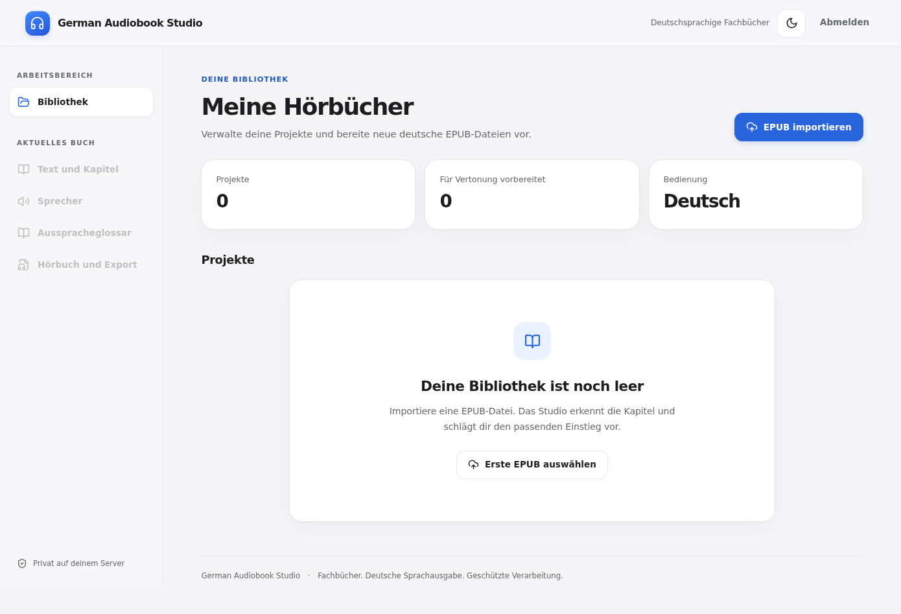
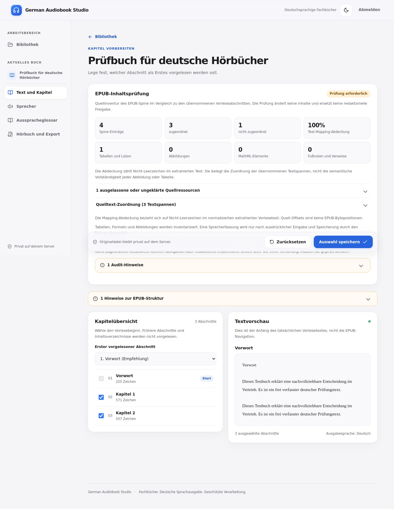
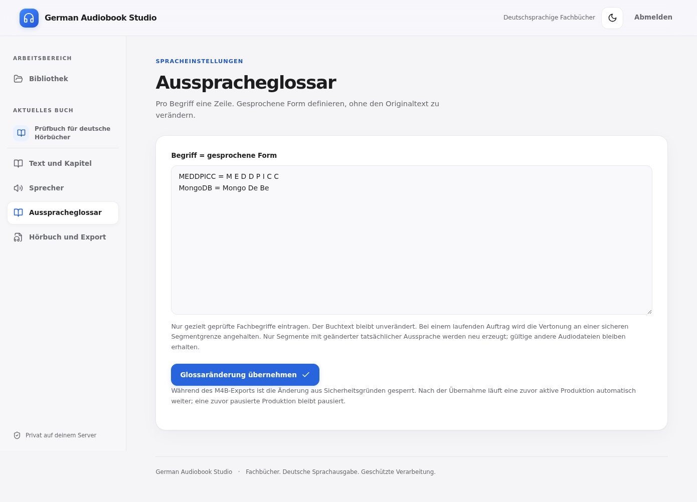
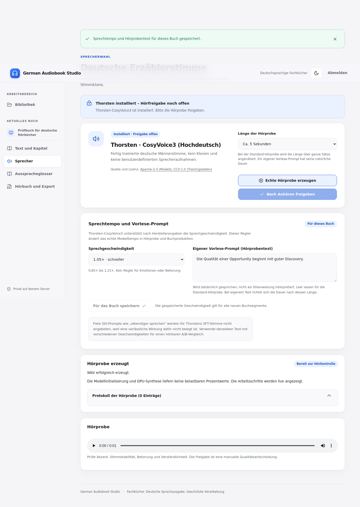
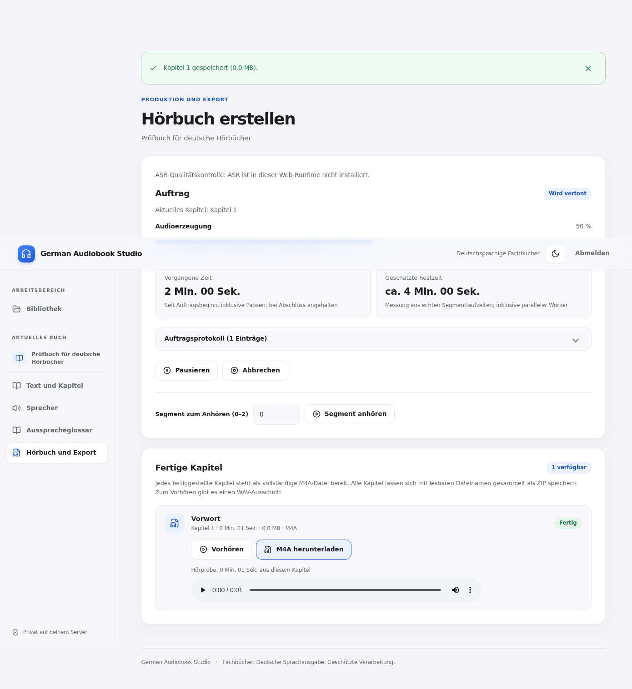
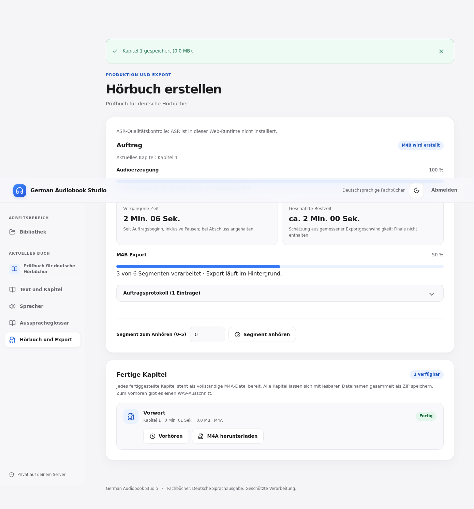
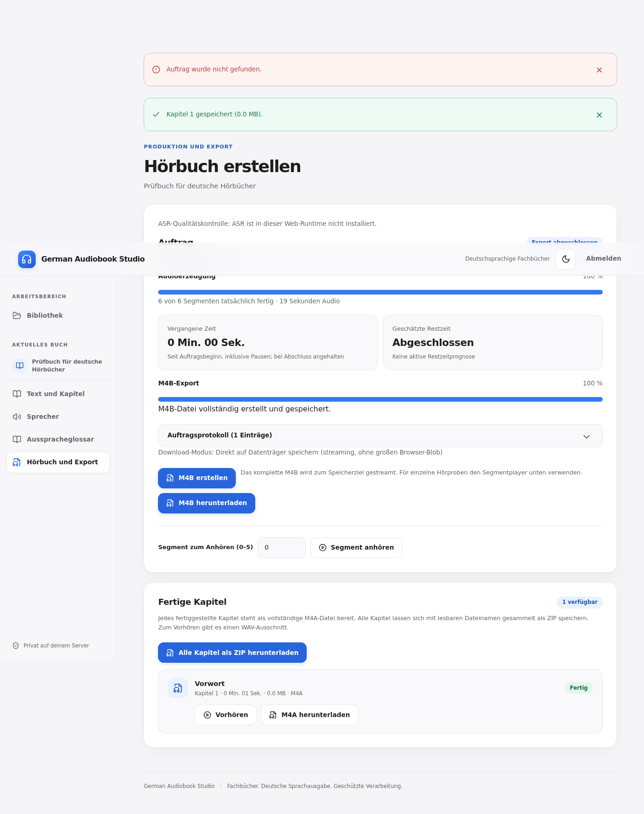

# German Audiobook Studio

**Aus einem deutschsprachigen EPUB ein Hörbuch machen – mit einer klaren Weboberfläche, einer echten deutschen Sprecherstimme und herunterladbaren Kapiteln.**

German Audiobook Studio liest EPUB-Dateien ein, lässt dich Kapitel und Aussprache kontrollieren, erstellt eine Hörprobe mit **Thorsten-CosyVoice3** und wandelt den gewählten Buchtext anschließend in Sprache um. Am Ende bekommst du ein **M4B-Hörbuch mit Kapitelmarken** und **einzelne M4A-Kapitel**, auf Wunsch zusammen als ZIP.

Du bedienst das Studio im Browser. Die aufwendige Spracherzeugung läuft auf einem **eigenen, kostenpflichtigen GPU-Pod bei RunPod**. Auf deinem Windows-Rechner brauchst du dafür keine Python-Umgebung.

> **Zu den Bildern:** Alle Abbildungen in dieser Anleitung sind **echte Chromium-Screenshots der tatsächlichen React-Weboberfläche**. Ein automatisierter Browsertest hat sie mit einem eigens erzeugten **Demo-EPUB**, einer synthetischen WAV-Hörprobe und simulierten Produktions-/Exportzuständen aufgenommen. Es sind **keine KI-generierten Mockups und keine Bilder eines echten GPU-Durchlaufs**. Die Werte und Buchtitel sind Demodaten.

## Inhalt

- [Was kann das Studio?](#was-kann-das-studio)
- [Installation auf RunPod](#installation-auf-runpod)
- [In sieben Schritten zum Hörbuch](#in-sieben-schritten-zum-hörbuch)
- [Was unterscheidet das Projekt?](#was-unterscheidet-das-projekt)
- [Kosten, Daten und Sicherheit](#kosten-daten-und-sicherheit)
- [Häufige Fragen und Probleme](#häufige-fragen-und-probleme)
- [Urheber, Modellquellen und Lizenzen](#urheber-modellquellen-und-lizenzen)
- [Technische Dokumentation](#technische-dokumentation)

## Was kann das Studio?

| Aufgabe | Was du davon hast |
| --- | --- |
| **EPUB importieren** | Buchtext und Kapitel werden erkannt und zur Kontrolle aufbereitet. |
| **Kapitel prüfen** | Du kannst festlegen, wo die Vertonung beginnen soll, und ungeeignete Abschnitte ausschließen. |
| **Ausspracheglossar pflegen** | Für Namen, Abkürzungen und Fachbegriffe legst du fest, was tatsächlich gesprochen wird. |
| **Hörprobe erstellen** | Du hörst Thorstens Stimme an, bevor du die gesamte Vertonung startest. |
| **Hörbuch erstellen** | Die Anwendung verarbeitet das Buch in nachvollziehbaren Segmenten, mit Fortschritt und einer vorsichtigen Restzeitschätzung. |
| **Arbeit fortsetzen** | Fertige Audiosegmente und Projektinformationen liegen auf einem persistenten Laufwerk. |
| **Kapitel früh herunterladen** | Bereits vollständig vertonte Kapitel stehen als M4A bereit. |
| **Fertiges Hörbuch exportieren** | Eine M4B-Datei mit Kapitelmarken und ein ZIP mit den einzelnen M4A-Kapiteln. |

Das ist keine Musik- oder Podcast-Anwendung. Das Studio ist auf **lange deutschsprachige Sach- und Fachtexte** und einen reproduzierbaren Hörbuch-Workflow ausgelegt.

## Installation auf RunPod

Die Einrichtung klingt aufwendiger, als die spätere Bedienung ist: Du wählst einmal einen GPU-Rechner bei RunPod, richtest ein dauerhaftes Laufwerk ein und setzt den Startbefehl ein. Danach erfolgt die Bedienung im Browser.

### 1. Was du brauchst

- Ein **RunPod-Konto** und eine funktionierende Zahlungsmethode. GPU-Laufzeit und Speicher können Kosten verursachen.
- Ein **Network Volume** im gleichen RunPod-Rechenzentrum wie dein Pod, empfohlen **80 GB oder mehr**, eingehängt unter `/workspace`.
- Einen GPU-Pod, beispielsweise mit **24 bis 32 GB Grafikspeicher**. Entscheidend ist, dass CUDA auf der zugewiesenen GPU tatsächlich funktioniert.
- Eine EPUB-Datei, für deren Verwendung du die erforderlichen Rechte hast.
- Einen Browser wie Chrome oder Edge für den direkten Download größerer Hörbuchdateien.

### 2. RunPod-Pod konfigurieren

Wähle **GPU Pod**, nicht Serverless. Lege ein privates Pod-Template mit diesen Werten an:

| Feld in RunPod | Einstellung |
| --- | --- |
| Image | `runpod/pytorch:1.0.2-cu1281-torch280-ubuntu2404` |
| GPU | GPU mit 24–32 GB VRAM; Verfügbarkeit und Preis vor dem Start prüfen |
| Container Disk | 15–20 GB als Planungswert |
| Network Volume | Dein Volume, eingehängt unter `/workspace` |
| Exposed HTTP Port | `7860/http` |
| Template-Zugriff | Privat |
| Optionales Secret | `AUDIOBOOK_STUDIO_TOKEN`, mindestens 32 Zeichen |

**Wichtig:** Ein Network Volume ist nicht dasselbe wie eine normale Container-Festplatte. Auf dem Volume werden deine Projekte, WAV-Dateien, Modelle und Exporte gespeichert. Hänge es beim nächsten Pod wieder unter **demselben Pfad** ein.

### 3. Startbefehl einfügen

Kopiere den folgenden **vollständigen Befehl** in RunPods Feld **Docker Start Command / Container Start Command**:

```bash
bash -lc '/start.sh & pod_pid=$!; if curl -fsSL https://raw.githubusercontent.com/thomasasen/tts-audiobook-tool/master/runpod/autostart.sh -o /tmp/tts-autostart.sh; then RUNPOD_WORKSPACE=/workspace AUDIOBOOK_DATA_ROOT=/workspace/audiobook-data RUNPOD_TTS_BRANCH=master RUNPOD_TTS_MODELS=none RUNPOD_TTS_START_TUI=0 RUNPOD_TTS_SKIP_VOICE_INSTALL=0 RUNPOD_TTS_DOWNLOAD_WORKERS=4 bash /tmp/tts-autostart.sh; rc=$?; if [ "$rc" -ne 0 ]; then echo "FEHLER: Audiobook-Start abgebrochen (Code $rc). RunPod-Logs pruefen und unbrauchbaren GPU-Pod im Dashboard STOPPEN!" >&2; fi; else echo "FEHLER: Audiobook-Startskript nicht geladen. GPU-Pod im Dashboard STOPPEN!" >&2; fi; wait "$pod_pid"'
```

Beim ersten Start lädt das Skript automatisch den Quellcode, richtet die Weboberfläche ein, prüft CUDA und installiert das CosyVoice-/Thorsten-Modell. Das kann wegen der großen Modelldateien dauern. Bei einem späteren Start werden korrekt gespeicherte Komponenten nach Möglichkeit wiederverwendet.

**Bei einem fehlgeschlagenen CUDA-Test** die privaten RunPod-Logs prüfen und den kostenpflichtigen Pod bei Bedarf stoppen. Ein Pod, der im Dashboard als „Running“ erscheint, ist **nicht automatisch** ein funktionsfähiger TTS-Rechner.

### 4. Studio öffnen und anmelden

1. Öffne in RunPod den laufenden Pod.
2. Klicke auf **Connect → HTTP Service 7860**.
3. Melde dich mit deinem **privaten Zugangsschlüssel** an. Wenn du `AUDIOBOOK_STUDIO_TOKEN` nicht selbst gesetzt hast, erzeugt das Studio einen Schlüssel und zeigt ihn in den **privaten RunPod-Container-Logs** an.
4. Warte auf einen funktionsfähigen Sprecherstatus, bevor du eine echte Hörprobe startest.

Den Zugangsschlüssel, private Logs und EPUB-Dateien **nicht in GitHub-Issues oder Screenshots veröffentlichen**.

## In sieben Schritten zum Hörbuch

### Schritt 1: Buch importieren

Öffne **Meine Hörbücher** und wähle deine **EPUB-Datei** aus. Die Anwendung importiert das Buch und legt ein Projekt an.



*Echte Weboberfläche, aufgenommen mit Chromium. Die Bibliothek ist im Demo-Ausgangszustand noch leer.*

### Schritt 2: Buch und Kapitel prüfen

Unter **Text und Kapitel** siehst du die erkannten Abschnitte. Prüfe vor allem den **ersten vorzulesenden Abschnitt**. Inhaltsverzeichnis, Impressum oder andere unerwünschte Teile lassen sich ausschließen. Speichere deine Auswahl, bevor du das Hörbuch erzeugst.



*Hier siehst du die echte Kapitel- und Inhaltsprüfung. Die Buchinhalte stammen aus einem synthetischen Test-EPUB.*

### Schritt 3: Aussprache verbessern

Öffne **Ausspracheglossar**. Für spezielle Begriffe kannst du eine gesprochene Form hinterlegen, beispielsweise `MongoDB = Mongo De Be`. Das Glossar hilft vor allem bei Abkürzungen, Produktnamen und Fachwörtern. Änderungen während einer laufenden Produktion werden an einer sicheren Segmentgrenze übernommen; möglicherweise müssen betroffene Segmente neu erzeugt werden.



*Die Beispiele im Screenshot sind nur Testdaten und keine allgemein gültigen Ausspracheempfehlungen.*

### Schritt 4: Stimme anhören und freigeben

Unter **Sprecher** verwendest du die deutsche Stimme **Thorsten**. Wähle die Hörprobendauer (5, 15, 30 oder 60 Sekunden) oder gib einen eigenen **vorzulesenden Testtext** ein. Stelle bei Bedarf das Sprechtempo ein, lasse die Hörprobe erzeugen und **höre sie vollständig an**. Erst danach kannst du den Sprecher freigeben.



*Wichtig: Die WAV im Screenshot ist ein synthetisches Browsertest-Signal, **keine echte Thorsten-Sprachausgabe**. Die reale Hörqualität musst du mit dem installierten Modell auf deinem Pod beurteilen.*

Ein freier „Sprich lebendiger“-Prompt ist für den hier verwendeten festgelegten Thorsten-SFT-Modus bewusst nicht angeboten, weil die Wirksamkeit solcher Anweisungen auf diesem Modellpfad nicht belegt ist.

### Schritt 5: Vertonung starten

Unter **Hörbuch und Export** startest du die Sprachgenerierung. Der Balken zeigt die **tatsächlich fertiggestellten Segmente**, nicht eine künstlich hochzählende Animation. Die Restzeit ist eine Schätzung aus bisherigen Laufzeiten. Du kannst pausieren und später fortsetzen. Bereits abgeschlossene Kapitel sind als einzelne M4A-Dateien verfügbar.



*Hier ist die echte Oberfläche zu sehen; die Segmentzahlen stammen aus einem kontrollierten Testauftrag, nicht aus einer mehrstündigen GPU-Produktion.*

### Schritt 6: Gesamtes Hörbuch erstellen

Wenn alle Audios fertig sind, starte **M4B erstellen**. Der Export wird im Hintergrund ausgeführt, damit längere Hörbücher keine zeitlich begrenzte Browseranfrage blockieren. Der Export hat einen **eigenen Fortschrittsbalken**. Bei der abschließenden Dateiverarbeitung erscheint noch keine voreilige 100-%-Meldung.



*Der sichtbare Exportstatus wird im Test über die reale API-Anbindung mit Demowerten gespeist.*

### Schritt 7: Hörbuch herunterladen

Ist der Export erfolgreich abgeschlossen, kannst du auswählen:

- **M4B herunterladen:** das gesamte Hörbuch in einer Datei mit Kapitelmarken, geeignet für viele Android-Hörbuchplayer.
- **Alle Kapitel als ZIP herunterladen:** alle fertiggestellten Kapitel als einzelne, sinnvoll benannte M4A-Dateien.
- **M4A herunterladen:** ein bestimmtes Kapitel einzeln speichern.



*Die Schaltflächen stammen aus der echten Anwendung. Die Testdaten simulieren einen abgeschlossenen Auftrag; die gezeigte Szene belegt keine echte Audioerzeugung.*

**Auf Android:** Mit einem geeigneten M4B-Hörbuchplayer kannst du direkt zwischen Kapiteln wechseln und die letzte Wiedergabeposition speichern. Eine Umwandlung in MP3 ist für solche Player normalerweise nicht nötig.

## Was unterscheidet das Projekt?

Es gibt viele Text-to-Speech-Programme. Der Schwerpunkt hier liegt nicht auf einer besonders großen Auswahl von Stimmen oder auf Klonen fremder Stimmen, sondern auf der **durchgängigen Produktion längerer deutscher Hörbücher**:

| German Audiobook Studio | Typischer einzelner TTS-Aufruf |
| --- | --- |
| EPUB importieren und seine Abschnitte prüfen | Text muss häufig vorher aufbereitet werden |
| Echte Sprecher-Hörprobe mit expliziter Freigabe | Qualitätsprüfung oft außerhalb des TTS-Aufrufs |
| Ausspracheglossar für Fachsprache | Aussprachekorrekturen häufig manuell im Eingabetext |
| Segmentbasierte Speicherung und Wiederaufnahme | Lange Aufträge müssen je nach Lösung neu gestartet werden |
| Fortschritt, Protokoll und vorsichtige Restzeitprognose | Ein einzelner Aufruf bietet nicht zwingend solche Übersichten |
| Kapitelweise M4A und vollständiges M4B mit Kapitelmarken | Roh-Audio benötigt eventuell weitere Bearbeitung |
| Optionaler Whisper-ASR-Qualitätscheck | Sprach-zu-Text-Kontrolle ist nicht Bestandteil jeder TTS-Lösung |
| Browserbedienung und automatisierter RunPod-Start | Andere Werkzeuge erfordern teils mehr manuelle Schritte |

Die rechte Spalte beschreibt **einzelne TTS-Aufrufe**, nicht alle konkurrierenden Hörbuchprogramme. Es handelt sich weder um eine Marktübersicht noch um einen Anspruch, diese Funktionen exklusiv anzubieten.

**Bewusste Grenzen:** Die Weboberfläche ist auf Thorsten-CosyVoice3 ausgelegt. Sie bietet keinen beliebigen Sprecherwechsel, keine Benutzer-Stimmklone und kein unbelegtes Prompt-Steuern von Emotionen. Die ursprüngliche, im Repository ebenfalls enthaltene Konsolenanwendung (TUI) unterstützt andere Modelle und Abläufe; diese sind **nicht automatisch Funktionen des Web-Studios**.

## Kosten, Daten und Sicherheit

**RunPod ist kostenpflichtig.** Während ein GPU-Pod läuft, können Gebühren anfallen; ein Network Volume kann auch im ausgeschalteten Zustand Speichergebühren verursachen. Preise hängen vom gewählten Angebot ab.

Das Studio verarbeitet Buch und Sprachdaten auf deinem **gemieteten RunPod-Pod** und speichert die Projektdaten unter `/workspace/audiobook-data`. Das ist **nicht dein lokaler Windows-Rechner**. Schütze den Zugangsschlüssel und verwende ein privates Pod-Template.

**Vor dem Löschen des Pods:** Lade die fertige M4B-Datei und – falls du später weiterarbeiten möchtest – auch die Produktionsdaten herunter. Wenn du ein Network Volume wiederverwendest, achte darauf, es beim nächsten Pod erneut einzuhängen. Während ein Export läuft, sollte der Pod nicht gestoppt werden.

**Urheberrecht:** Du bist selbst dafür verantwortlich, dass du den Buchtext verarbeiten und gegebenenfalls veröffentlichen darfst. Eine rechtmäßig erstellte private Vertonung bedeutet **nicht automatisch**, dass du das Hörbuch öffentlich, etwa auf Spotify, hochladen darfst.

## Häufige Fragen und Probleme

**Das Studio ist nicht erreichbar.** Prüfe, ob der Pod wirklich läuft, der Port `7860/http` konfiguriert ist und **Connect → HTTP Service 7860** funktioniert. Ein gestarteter Container garantiert noch keine betriebsbereite Webanwendung.

**Thorsten ist noch nicht bereit.** Der Erststart lädt große Modellgewichte und führt CUDA-Tests aus. Prüfe den Sprecherstatus und die privaten RunPod-Logs. Ein fehlerhafter CUDA-Host sollte nicht unnötig weiterlaufen.

**Die Hörprobe ist nicht abspielbar.** Prüfe das Hörproben-Protokoll, die Meldung im Browser und das Webserver-Log. Das Modell muss eine gültige WAV-Datei erzeugen; eine leere Datei ist keine erfolgreiche Hörprobe.

**Die Restzeit springt oder verschwindet.** Die Prognose wird aus tatsächlichen Messwerten ermittelt. Bei wenigen Messpunkten, Pausen, Stillstand oder abschließender Dateiverarbeitung wird lieber **keine erfundene Zeit** angezeigt.

**Der Download ist sehr groß.** Für große M4B- und ZIP-Dateien empfiehlt sich Chrome oder Edge mit direktem Speichern auf die Festplatte. Bei unbekannter ZIP-Gesamtgröße zeigt der Balken den übermittelten Datenstand ohne erfundene Prozentzahl.

**Ein Export wurde unterbrochen.** Die fertig erzeugten WAV-Segmente bleiben auf dem persistenten Laufwerk erhalten. Nach einem kontrollierten Neustart kann ein fehlgeschlagener M4B-Export erneut angestoßen werden, ohne den gesamten Buchtext erneut zu sprechen.

**Privates Webserver-Log anzeigen:** Öffne die RunPod-Konsole und führe dort aus:

```bash
tmux capture-pane -pt audiobook-web -S -150 | tail -n 100
```

Im Fehlerfall keine Zugangsschlüssel oder personenbezogenen Buchinhalte öffentlich teilen.

## Urheber, Modellquellen und Lizenzen

Dieses Projekt verbindet eigene Web-Studio-Erweiterungen mit bestehenden Open-Source-Komponenten. Sie verdienen eine **klare und überprüfbare Nennung**:

- **Ursprüngliches Projekt:** [zeropointnine/tts-audiobook-tool](https://github.com/zeropointnine/tts-audiobook-tool) – Grundlage der Konsolenanwendung und des Audiobook-Workflows. Die ursprüngliche Dokumentation ist vollständig unter [Technische und ursprüngliche README](docs/technical-and-upstream-readme.md) archiviert. Der Quellcode dieses Repositorys steht gemäß [LICENSE](LICENSE) unter MIT.
- **Deutsche Sprecherstimme:** [Thorsten-Voice](https://thorsten-voice.de/) und das Fine-Tuning [Thorsten-Voice/CosyVoice3](https://huggingface.co/Thorsten-Voice/CosyVoice3). Die deutsche Stimme stammt nicht von den Entwicklern dieser Weboberfläche. Das Fine-Tuning wird laut Modellkarte unter **Apache-2.0**, der zugrunde liegende Thorsten-Voice-Datensatz unter **CC0** bereitgestellt.
- **TTS-Basismodell:** [FunAudioLLM / CosyVoice](https://github.com/FunAudioLLM/CosyVoice), insbesondere [Fun-CosyVoice3-0.5B-2512](https://huggingface.co/FunAudioLLM/Fun-CosyVoice3-0.5B-2512). Das Web-Studio verwendet den Thorsten-Fine-Tune dieses Basismodells; die jeweilige Modelllizenz gilt zusätzlich zur Lizenz des Anwendungscodes.
- **Optionale Qualitätssicherung:** [faster-whisper](https://github.com/SYSTRAN/faster-whisper) bzw. [Whisper](https://github.com/openai/whisper) zur Prüfung erstellter Sprache, sofern die ASR-Funktion eingerichtet ist.
- **Betriebsplattform:** [RunPod](https://www.runpod.io/) stellt die mietbare GPU-Infrastruktur bereit; RunPod ist weder der Urheber der Stimme noch des Basismodells.

**Wissenschaftliche CosyVoice-Referenz:** Du et al., *CosyVoice 3: Towards In-the-wild Speech Generation via Scaling-up and Post-training*, arXiv:2505.17589 (2025); siehe die [offizielle Thorsten-Modellkarte](https://huggingface.co/Thorsten-Voice/CosyVoice3).

Die genannten Rechte gelten für **Code, Modelle und Sprachdatensätze jeweils getrennt**. Sie geben keine Veröffentlichungsrechte an den EPUB-Inhalten.

## Technische Dokumentation

- [Vollständige frühere README mit RunPod-Details und ursprünglicher TUI-Dokumentation](docs/technical-and-upstream-readme.md)
- [RunPod-Installationsanleitung](runpod/README.md)
- [Quellcode der Weboberfläche](web/src/)
- [Reproduzierbarer Chromium-Browsertest für diese echten Screenshots](tests/web/browser_smoke.py)
- [Automatisierte Qualitätssicherung (GitHub Actions)](.github/workflows/german-audiobook-studio.yml)

**Hinweis für Mitwirkende:** Screenshots für die README werden aus dem tatsächlich gebauten React-Frontend mit einem synthetischen Test-EPUB und kontrollierten Demo-API-Daten erstellt. Es dürfen keine generierten UI-Mockups oder privaten RunPod-Zugangsdaten als Screenshots ausgegeben werden.
